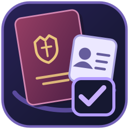

<p align="center">
  
</p>

# Student Passport Monitor

Небольшая программа для учёта паспортов студентов. Я делаю её для того, чтобы не приходилось постоянно проверять Excel-таблицы вручную и вспоминать, кому скоро исполнится 20 или 45 лет.

Программа работает на Windows, хранит данные на компьютере и напоминает, когда стоит проверить паспорт студента. Это именно напоминания, а не автоматическая проверка действительности документа.

## Что умеет

- Загружать списки студентов из Excel (`.xls` и `.xlsx`).
- Добавлять, редактировать и удалять студентов вручную.
- Искать студентов по списку и фильтровать их по группам.
- Предупреждать о приближении 20-летия и 45-летия.
- Показывать студентов, чьи документы нужно проверить, в отдельной вкладке.
- Запоминать дату последней проверки и вести историю запусков мониторинга.
- Сохранять резервную копию перед импортом и восстанавливать её при необходимости.
- Выгружать отчёты в Excel — по всем студентам, отдельной группе, предупреждениям или незаполненным данным.
- Работать в трее и при необходимости запускаться вместе с Windows.

## Иконка приложения

Иконка используется в окне программы, на панели задач, в системном трее и в установщике. Исходный рисунок находится в `assets/student-passport-monitor.svg`. Перед сборкой на Windows скрипт `scripts/generate-icon.ps1` создаёт многоразмерный `.ico` для исполняемого файла.

## Установка и запуск

Готовый установщик для Windows x64 можно найти в разделе [Releases](https://github.com/Hentrix/Student-Passport-Monitor/releases).

Для запуска из исходников нужен **.NET 10 SDK**. Проект написан на C# с использованием Windows Forms.

```powershell
git clone https://github.com/Hentrix/Student-Passport-Monitor.git
cd Student-Passport-Monitor
dotnet restore
dotnet run
```

Если просто закрыть окно, программа останется работать в трее. Чтобы полностью её выключить, выберите «Выход» в меню значка рядом с часами.

## Как это работает

Сначала нужно загрузить список студентов из Excel или добавить записи вручную. Перед импортом программа покажет, сколько студентов удалось прочитать и каких данных не хватает.

При повторном импорте можно объединить записи с уже существующими. Пустые ячейки из Excel не должны стирать сохранённые паспортные сведения. Перед импортом создаётся резервная копия, так что при ошибке можно вернуть предыдущий список.

Есть один нюанс: пока студенты сопоставляются по ФИО и группе. Если студент сменил фамилию или перешёл в другую группу, может появиться дубликат. Такие случаи лучше проверять вручную.

### Напоминания о замене паспорта

По умолчанию программа начинает предупреждать за 90 дней до 20-летия или 45-летия. Этот срок можно изменить в настройках.

После наступления контрольной даты программа просит проверить сведения о замене паспорта. Если дата выдачи нового документа уже известна, её можно указать в карточке студента.

Отметка о том, что сведения проверены, сама по себе не означает, что паспорт заменён. Предупреждение исчезнет только после внесения соответствующей даты выдачи или замены.

**Важно:** программа не определяет юридическую действительность паспорта. Возраст и прошедшие 90 дней используются для напоминаний; реальные сроки и исключения нужно проверять по действующему законодательству.

## Где хранятся данные

Всё сохраняется локально, в папке:

```text
%LOCALAPPDATA%\StudentPassportMonitor\
```

Основные файлы:

- `students.json` — список студентов;
- `settings.json` — настройки;
- `check-history.json` — история проверок;
- `backups\` — резервные копии.

Данные не отправляются в GitHub или на сторонние серверы. При удалении приложения пользовательские файлы сохраняются.

**Обратите внимание:** JSON-файлы не зашифрованы. Поскольку в базе могут находиться персональные данные и номера паспортов, стоит ограничить доступ к компьютеру и использовать шифрование диска. Реальные списки студентов нельзя добавлять в репозиторий.

## Сборка и тесты

Для проверки проекта:

```powershell
dotnet build
dotnet test tests/StudentPassportMonitor.Tests/StudentPassportMonitor.Tests.csproj -c Release
```

Автотесты проверяют расчёт возрастных рубежей и объединение данных студентов.

В GitHub Actions настроены тестирование, сборка Windows-версии и создание установщика через Inno Setup. При обычных изменениях в `main` запускаются проверки; выпуск установщика и публикация GitHub Release выполняются по тегу версии. Устаревшие проверки отменяются, чтобы не тратить время на сборку промежуточных коммитов.

Установщик пока не подписан цифровым сертификатом, поэтому Windows SmartScreen может показать предупреждение.

## Версии

Использую формат `MAJOR.MINOR.PATCH`, например `1.0.0`:

- **MAJOR** — большие изменения, которые могут нарушить совместимость;
- **MINOR** — новые возможности;
- **PATCH** — исправления ошибок.

Номер версии находится в `Directory.Build.props` (свойство `VersionPrefix`).

Чтобы выпустить следующую версию, нужно изменить номер в этом файле, отправить коммит и создать соответствующий тег. Например, для `1.1.0`:

```powershell
git add Directory.Build.props
git commit -m "Подготовить выпуск версии 1.1.0"
git push origin main
git tag v1.1.0
git push origin v1.1.0
```

Тег лучше отправлять после успешного прохождения проверок в GitHub Actions.

## Структура проекта

- `Forms/` — окна и элементы интерфейса.
- `Core/` — основная логика приложения.
- `Models/` — модели данных.
- `Services/` — работа с Excel, JSON, уведомлениями и контрольными датами.
- `tests/` — автоматические тесты.
- `installer/` — настройки установщика.
- `.github/workflows/` — автоматическая сборка и публикация релизов.
